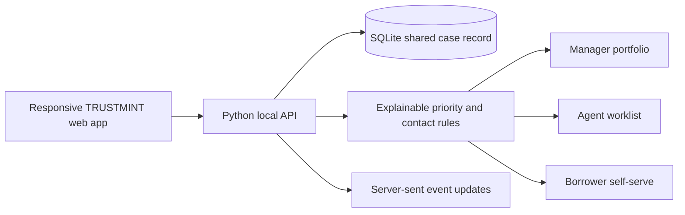

# TRUSTMINT

TRUSTMINT is a synthetic-data demo for Quasar 5.0 FinTech PS-1 (RecoverIQ): one shared, auditable recovery workflow for managers, field agents and borrowers.

## Combined teammate and team app

This branch preserves the teammate's original front-end prototype in `index trustmint1.html` and adds the integrated TRUSTMINT app at the project root. We carried over the useful feature navigation, case review, multilingual reminder preview, and contact-limit guard, and wired them to the shared case API and synthetic SQLite records. The teammate file's hard-coded demonstration balances and audit rows remain in that original prototype only; the integrated app uses the database-backed demo records.

## Run locally

Requires Python 3.10+. No database server or API key is needed.

```powershell
npm run dev
```

You can also start it directly with `python run.py`.

Then open the `TRUSTMINT is ready at ...` URL in the terminal (normally http://127.0.0.1:8000). State is stored in `trustmint.db`; remove that file to reset the demo. All names, account records, events and coordinates are fictional. Payments and contact channels are simulated.

Keep the terminal running while using the site. It prints `TRUSTMINT is ready at ...` once the server has started. If you choose VS Code Live Server instead, the root page opens the app at port 5500; start `python run.py` in a second terminal as its API. If port 8000 is already in use, start with `$env:PORT=5173; npm run dev` in PowerShell and open the URL printed in that terminal.

## Demo roles

Choose Manager, Agent or Borrower on the sign-in screen. The three role cards use seeded demo accounts. From the floating Demo mode control you can simulate a confirmed payment, field visit, high-risk case and blocked duplicate reminder.

## What is implemented

- Case portfolio, priority sorting, explainable rule-based risk, risk bands, suggested channels and manager assignment.
- Mobile agent case list, case details, GPS-stamped visit logging, call outcomes, promise-to-pay and digital-first follow-up.
- Borrower loan/dues view, EMI breakdown, transparent contact timeline, simulated confirmed payment, assistance request and multilingual assistant (English, Hindi, Marathi).
- Respectful simulated reminders with duplicate, contact-frequency, quiet-hour and consent checks.
- Shared SQLite account record, role-restricted views, immutable-style audit events, server-sent updates and a lightweight one-second change check.
- Live sync indicator with last-check age and reconnect status, persistent light/dark theme, and a borrower repayment plan estimator that submits a human-reviewed support request.
- City recovery sentiment, borrower note capture, broken-promise visibility and workload indicators.

## Architecture



Risk scoring uses explicit, inspectable rules. The PS-1 allows rule-based risk scoring; the attached product brief's scikit-learn model is not part of this compact local prototype.

## Three-minute demo

1. Sign in as Manager; show portfolio KPIs, priority queue, city sentiment, audit trail and agent workload.
2. Assign a high-priority case and send a polite digital reminder; use Demo mode to show a duplicate being blocked.
3. Switch to Agent; open the assigned case, capture a multilingual borrower note and GPS-stamped visit.
4. Switch to Borrower; review the exact due breakdown and contact history, then make the simulated payment.
5. Return to Manager and show the shared case update, receipt event and audit record.

API endpoints are served under `/api`; the browser app uses the same local API. This demo is not connected to a real bank, messaging provider or payment gateway.
